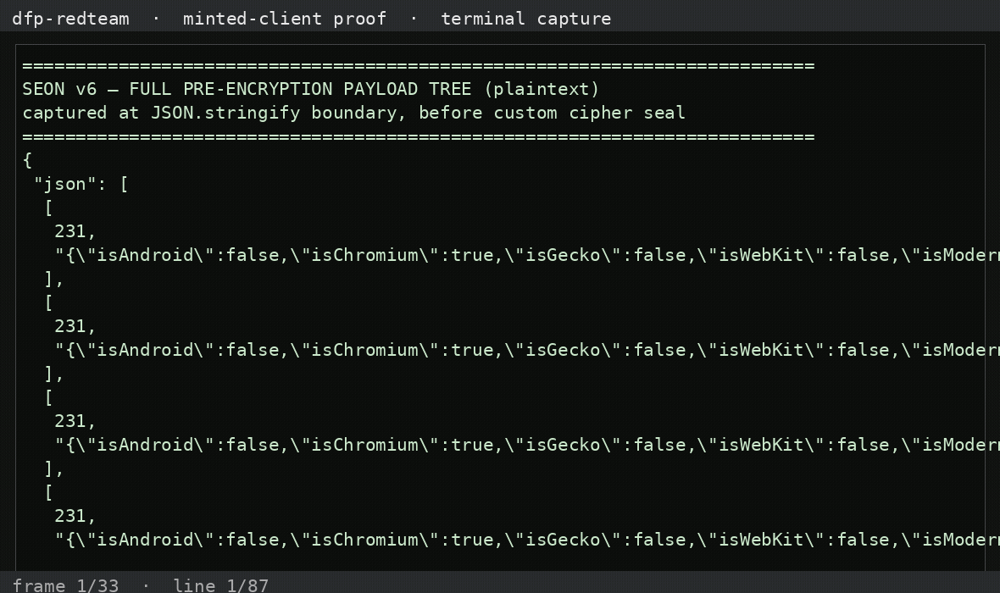

# dfp-redteam-seon — SEON v6 device-fingerprint SDK

Client-side red-team of SEON's JS SDK. Full details in `SEON_WRITEUP_2026_10_31.md`.

---

## What we observed (the shipped payload)

**The pre-encryption payload is a fully readable JSON tree — captured at the
`JSON.stringify` boundary before the custom cipher seals it.** Key facts:

- **9,713-byte** pre-encryption fingerprint tree read in full (2,857-string
  obfuscation table recovered).
- Custom cipher (`W;ver;salt;cipher`) — no WebCrypto/AES-GCM; session fully
  **client-minted with zero network calls**.
- Every signal tamperable before sealing (tz/canvas/webdriver differential
  proven).
- DNS-exfil to `*.seondnsresolve.com`.

The full payload tree (navigator, canvas, webgl, fonts, screen, mouse, storage
probes) is readable end-to-end — see the writeup's captured JSON.

## Status

- 🟢 Read payload: full pre-encryption tree at `JSON.stringify` (plaintext)
- 🟢 Tamper with payload: mint + tamper any signal before the custom cipher seals it
- 🟢 Mint token: session (`W;ver;salt;cipher`) fully client-minted

## Demo video — the full pre-encryption payload

**Watch the capture** (terminal capture of `scripts/demo-seon.py` printing the
complete payload tree — canvas, webgl, fonts, screen, UA probes — as it exists
before the custom cipher seals it, no truncation):



<video controls preload="metadata" width="720"><source src="assets/videos/full-payload-demo.mp4" type="video/mp4"></video>

Reproduce it yourself:

```bash
python3 scripts/demo-seon.py artifacts/plaintext2.json
```

Full payload artifacts: [plaintext2.json](artifacts/plaintext2.json) ·
[full-tree.json](artifacts/full-tree.json) ·
[tamper-results.json](artifacts/tamper-results.json)
[Download the mp4](https://raw.githubusercontent.com/JWally/dfp-redteam-seon/main/assets/videos/full-payload-demo.mp4)

## Files

- writeup: `SEON_WRITEUP_2026_10_31.md`
- scripts + artifacts in `scripts/` and `artifacts/` (per the writeup)
